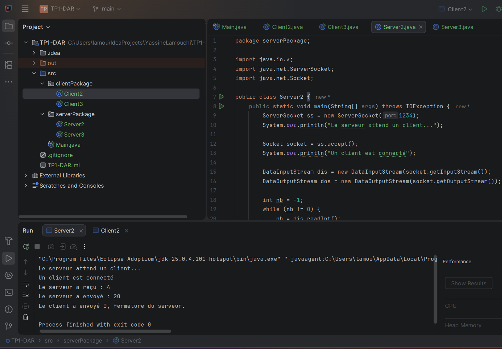
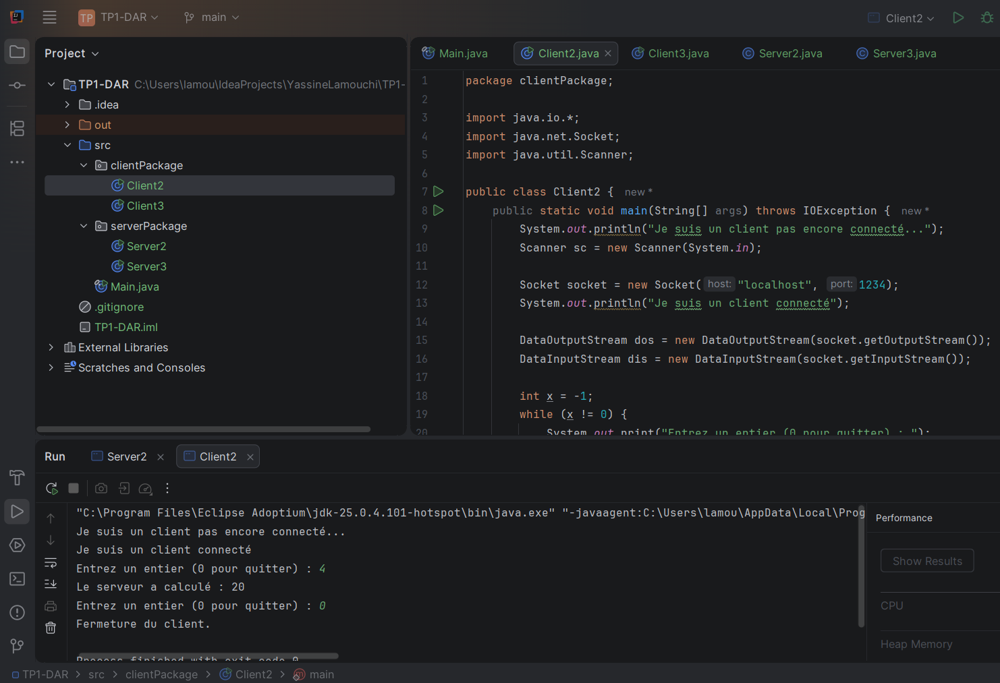
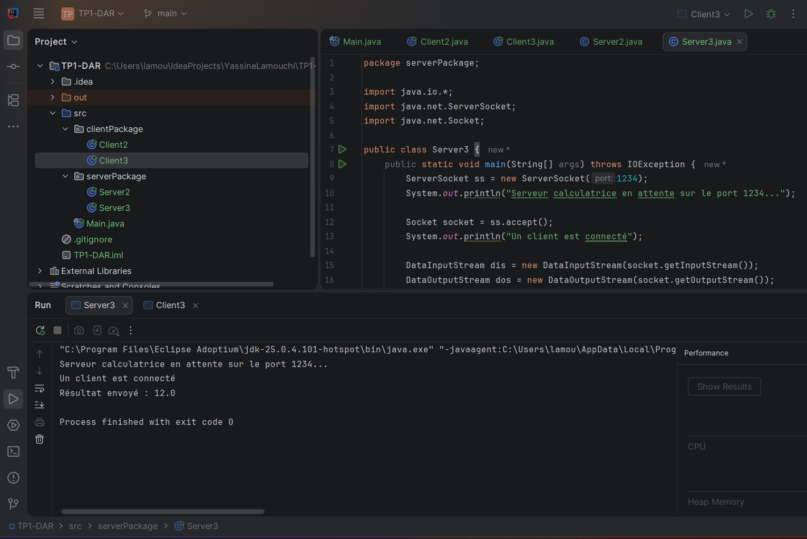
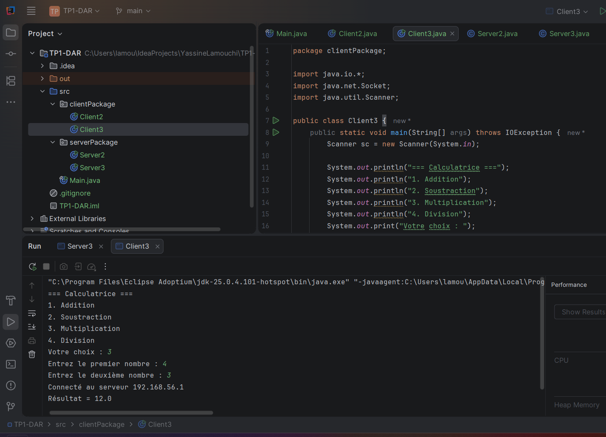
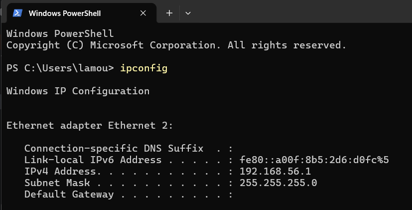

# TP1-DAR – Développement d'Applications Réparties

**Étudiant :** Yassine Lamouchi  
**Groupe :** LSI3 2.1  
**Année universitaire :** 2026-2027  
**Enseignante :** Mme Amal ABID  

---


```text
TP1-DAR/
├── README.md
├── src/
│   ├── clientPackage/
│   │   ├── Client2.java
│   │   └── Client3.java
│   └── serverPackage/
│       ├── Server2.java
│       └── Server3.java
└── captures/
    ├── Server2.png
    ├── Client2.png
    ├── Server3.png
    ├── Client3.png
    └── terminal.png
```

## Activité 2 : Service de multiplication (x * 5)

### Explication

Le client se connecte au serveur sur le port `1234`.  
Il saisit des entiers au clavier et les envoie un par un.  
Le serveur lit chaque entier, calcule `x * 5` et renvoie le résultat.  
La boucle s'arrête lorsque le client saisit `0`.  
Les deux programmes ferment alors proprement leurs sockets.

### Capture console – Serveur (Server2)



### Capture console – Client (Client2)



---

## Activité 3 : Calculatrice améliorée (4 opérations)

### Explication

Le client affiche un menu avec 4 opérations : Addition, Soustraction, Multiplication, Division.  
Il demande ensuite deux nombres à l'utilisateur.  
Le client envoie le choix de l'opération et les deux nombres au serveur.  
Le serveur effectue le calcul et renvoie soit le résultat, soit une erreur si la division par zéro est demandée.  
Le client affiche le résultat.

> ⚠️ **Avant d'exécuter :** dans `Client3.java`, remplacez `"192.168.56.1"` par l'adresse IP réelle de votre PC serveur (obtenable avec `ipconfig` sous Windows).

### Capture console – Serveur (Server3)



### Capture console – Client (Client3)



### Capture terminal – commande `ipconfig`

Cette capture montre la commande `ipconfig` exécutée sur le PC serveur pour récupérer son adresse IP locale.



---

## Comment exécuter les programmes

1. Ouvrir le projet dans IntelliJ IDEA (ou Eclipse).
2. Lancer d'abord `Server2.java` (ou `Server3.java`).
3. Lancer ensuite `Client2.java` (ou `Client3.java`).
4. Suivre les instructions affichées dans la console.
